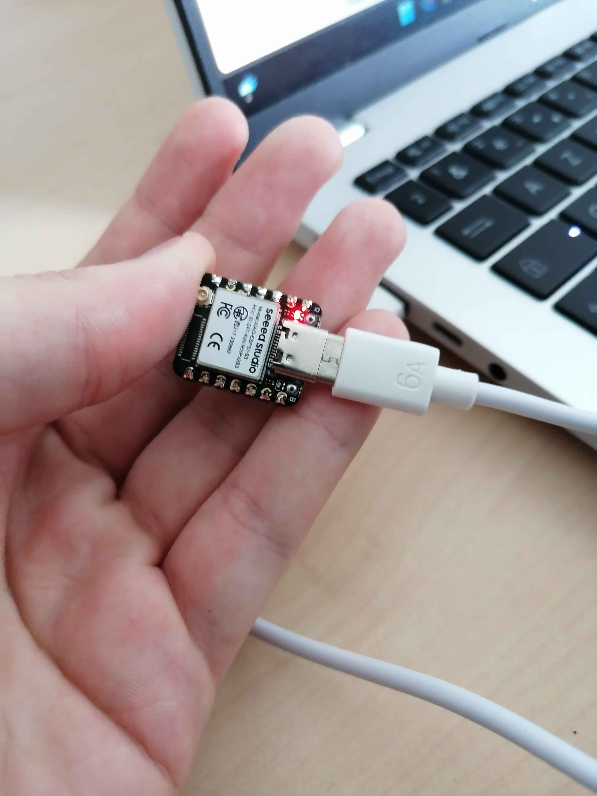
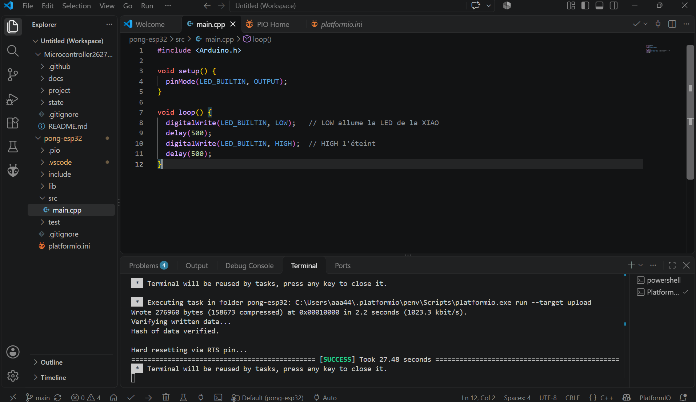

# 2026-11-18 : Vérification de la toolchain ESP32-S3

**Séance :** planifiée · **Durée :** 2 h

## Fait

Nous avons préparé la carte Seeed Studio XIAO ESP32S3, configuré PlatformIO et validé le premier flashage.

- Brasage : avant d'utiliser la carte, nous avons brasé les pattes (barrettes) de l'ESP32-S3.
- Création du projet PlatformIO `pong-esp32` dans le dépôt du groupe (board : Seeed Studio XIAO ESP32S3, framework : Arduino), avec `monitor_speed = 115200` ajouté dans `platformio.ini`.
- Branchement de la carte avec un câble USB-C data : la carte est alimentée (LED rouge allumée) et, sous Windows, un nouveau port COM apparaît dans le Gestionnaire de périphériques.

  ![Carte XIAO ESP32S3 branchée en USB-C à l'ordinateur]

- Remplacement du contenu de `src/main.cpp` par le programme de blink de base, puis upload depuis la barre bleue de PlatformIO. Le téléversement réussit : 276 960 octets écrits, hash vérifié, `[SUCCESS]` en 27,48 s.

  ![Code du blink et upload réussi dans VSCode]

- Validation individuelle : la LED orange intégrée (`LED_BUILTIN`) clignote à 1 Hz.

## Pourquoi

Le but est de vérifier que chacun dispose d'une chaîne de développement fonctionnelle avant la suite des TD. Nous avons brasé les pattes avant la première utilisation pour pouvoir brancher la carte sur les montages ensuite. Nous avons gardé `#include <Arduino.h>` en tête de `main.cpp` : sans cette ligne, `pinMode`, `digitalWrite` et `Serial` sont inconnus et la compilation échoue. Aucun driver n'est nécessaire, car la XIAO utilise l'USB natif de l'ESP32-S3. Sur cette carte, la LED est câblée en logique inversée : `LOW` l'allume et `HIGH` l'éteint. Dans le test série, le `delay(1500)` laisse le temps au PC de rouvrir le port, car l'USB est natif. Le format `nom:valeur` permet de tracer la courbe dans Teleplot.

## Reste à faire

- Passer à l'étape suivante du tutoriel : « VSCode et PlatformIO : port série ».
- Téléverser le premier exemple : envoyer `sin:` suivi de la valeur de `sin(i)` à 115200 bauds, avec `monitor_speed = 115200` dans `platformio.ini`.
- Lire les valeurs dans le moniteur série de PlatformIO.
- Installer l'extension Teleplot dans VSCode et tracer les données sous forme de courbes.
- Ensuite : ajout d'une LED externe, puis les modules de la mallette (TD2) et la conception de la carte (TD3).
- En cas d'échec d'upload (« Failed to connect » ou port introuvable) : mode téléversement forcé avec le bouton BOOT, puis RESET.