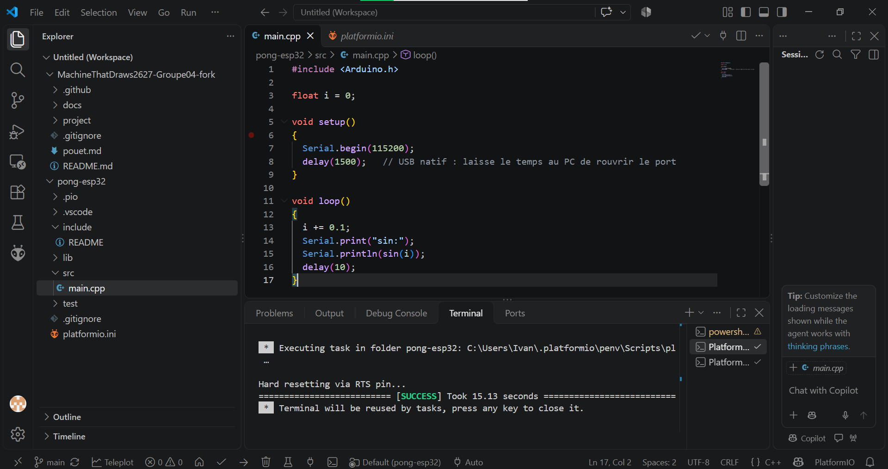
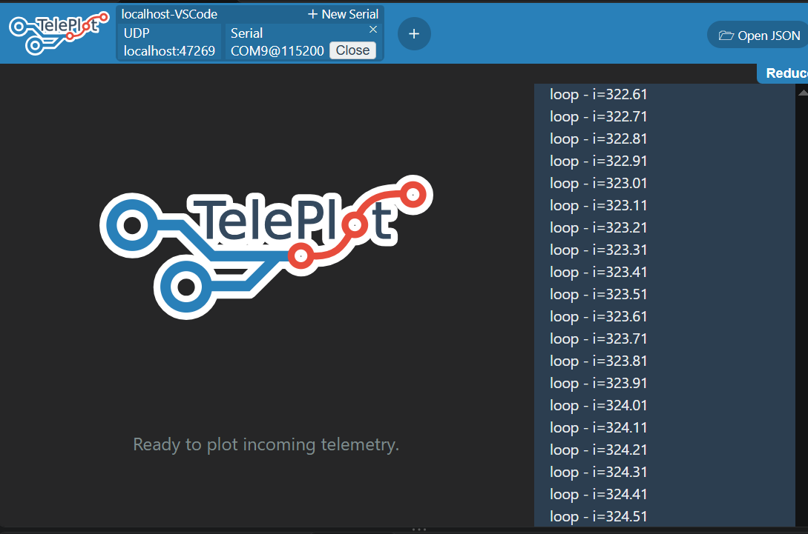
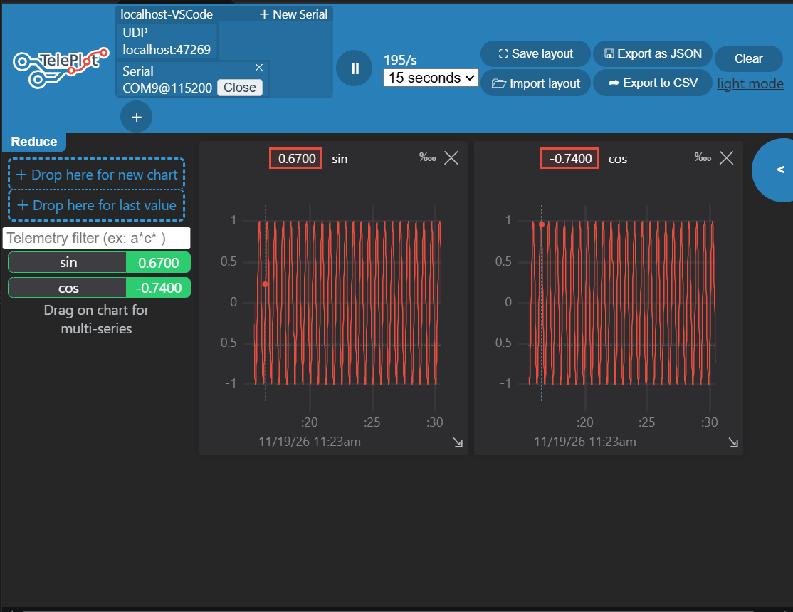
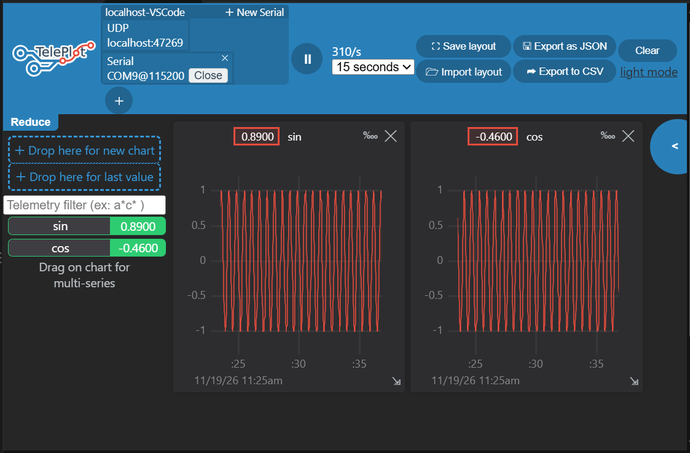

# 2026-11-19 : Port série et Teleplot

**Séance :** planifiée · **Durée :** 2 h

## Fait

Nous avons suivi le tutoriel « VSCode et PlatformIO : port série » : envoyer des données depuis la XIAO ESP32S3, les lire dans le moniteur série, puis les tracer avec Teleplot.

- Programme d'essai : il envoie `sin:` suivi de la valeur de `sin(i)` à 115200 bauds, avec `Serial.begin(115200)`, un `delay(1500)` au démarrage et un `delay(10)` dans la boucle, où `i` augmente de 0,1 à chaque tour.
- Vitesse du moniteur : `monitor_speed = 115200` dans `platformio.ini`.
- Téléversement réussi : `[SUCCESS]` en 15,13 s.

  ![Programme sinus et upload réussi dans VSCode]

- Installation de l'extension Teleplot depuis le gestionnaire d'extensions de VSCode, puis ouverture avec le bouton Teleplot de la barre inférieure.
- Connexion de Teleplot à la carte : port série COM9 à 115200 bauds.
- Affichage textuel : en envoyant une valeur sous la forme `loop - i=...`, Teleplot l'affiche comme texte dans le terminal de droite, sans tracer de courbe.

  ![Teleplot connecté sur COM9 à 115200 bauds, valeurs reçues en texte]

- Tracé de courbes : avec le format `nom:valeur`, Teleplot trace les courbes `sin` et `cos` dans deux graphiques séparés, avec une fenêtre de 15 secondes.

  ![Courbes sin et cos tracées dans Teleplot]

- Second essai : les courbes sont affichées à un débit plus élevé (environ 310 valeurs par seconde, contre 195 sur le premier essai).

  ![Courbes sin et cos tracées dans Teleplot, second essai]

## Pourquoi

Le port série permet de voir ce que fait la carte pendant l'exécution. Sur la XIAO ESP32S3, `Serial` passe par l'USB natif de l'ESP32-S3 : le port disparaît un instant à chaque reset ou upload, d'où le `delay(1500)` au démarrage, qui laisse au PC le temps de rouvrir le port. Nous avons choisi 115200 bauds des deux côtés (dans `Serial.begin` et dans `monitor_speed`), car les deux appareils doivent être réglés sur la même vitesse. Teleplot ne trace une courbe que si les données sont envoyées au format `nom:valeur` : sinon, il affiche seulement du texte. Nous l'utilisons parce qu'une courbe se lit beaucoup mieux qu'une suite de nombres dans le terminal.

## Reste à faire

- Passer au TD suivant : « Les modules de la mallette » (tester bouton, joystick, buzzer et écran sur breadboard, un par un, avant de concevoir la carte).
- Câbler chaque module sur la XIAO ESP32S3 en 3,3 V uniquement (jamais en 5 V), et regrouper les broches dans un fichier `include/config.h`.
- Tester le bouton : lecture de son niveau avec `INPUT_PULLUP`, puis détection d'un seul appui avec l'anti-rebond.
- Tester le joystick : lecture des valeurs brutes des axes X et Y et du bouton, puis calibrage et normalisation des valeurs.
- Tester le buzzer et l'écran TFT.
- Ensuite : la conception de la carte (TD3).
- En cas d'échec d'upload (« Failed to connect » ou port introuvable) : mode téléversement forcé avec le bouton BOOT, puis RESET.