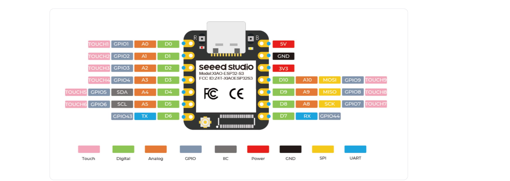
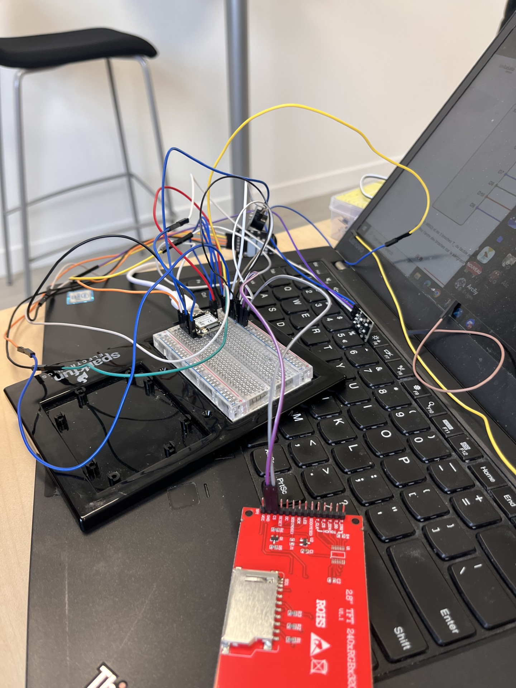

# 2026-11-24 : Câblage des modules de la mallette

**Séance :** planifiée · **Durée :** 1 h 30 (13 h à 14 h 30)

## Fait

Nous avons commencé le TD « Les modules de la mallette » : brancher sur une breadboard les quatre modules de la future console (bouton, joystick, buzzer et écran TFT) à la carte XIAO ESP32S3, avant de les tester un par un.

- Repérage des broches de la XIAO ESP32S3 à l'aide de son schéma de brochage.

  ![Schéma de brochage de la XIAO ESP32S3]

- Câblage des modules sur la breadboard selon le tableau du tutoriel :

  | Module | Broche du module | Broche XIAO |
  |---|---|---|
  | Bouton | Signal (`S`) | D5 |
  | Joystick | `VRx` | D0 (ADC1) |
  | Joystick | `VRy` | D1 (ADC1) |
  | Joystick | `SW` (appui sur le stick) | D2 |
  | Buzzer | Signal (`S`) | D3 |
  | Écran | `SCK` | D9 |
  | Écran | `SDI` / `MOSI` | D10 |
  | Écran | `DC` | D8 |
  | Écran | `RESET` | D7 |
  | Écran | `CS` | GND |
  | Écran | `LED` (rétroéclairage) | 3V3 |
  | Tous | `VCC` / `GND` | 3V3 / GND |

- Alimentation de tous les modules par la broche 3V3 de la XIAO, jamais en 5 V.

  ![Montage des modules sur la breadboard, relié à la XIAO ESP32S3 et à l'écran TFT]

## Pourquoi

Avant de concevoir la carte de la console (TD3), nous vérifions chaque module séparément sur breadboard : comment il se branche, comment il se programme. Cela évite de découvrir une erreur de câblage une fois la carte fabriquée. Nous alimentons tout en 3,3 V, car les entrées de l'ESP32-S3 ne supportent pas plus de 3,3 V : un module prévu pour 5 V fonctionne presque toujours en 3,3 V, mais l'inverse peut détruire la carte. Le pin `CS` de l'écran est relié à GND, ce qui évite d'utiliser une broche pour lui. Le buzzer est branché sur D3 seulement sur la breadboard, car D3 sert au connecteur sur la carte de la console.

## Reste à faire

- Prochaine séance : installer KiCAD sur notre système d'exploitation (étape 6 du projet, 1 h).
- Ensuite : importer des librairies de composants dans KiCAD (étape 7, 1 h).